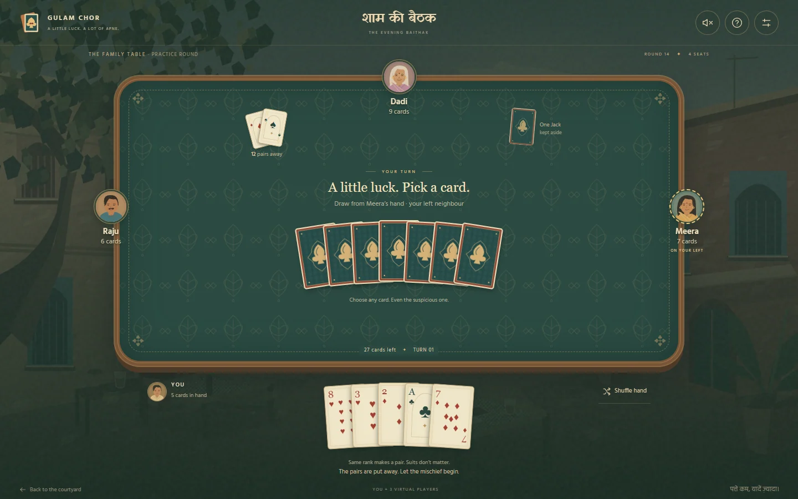

# Gulam Chor · गुलाम चोर

A nostalgic Indian courtyard, a familiar deck, and one Jack nobody wants to keep.

This is a **playable visual preview** built with **Next.js, React, TypeScript, and Tailwind CSS**, prepared for **Vercel**. The flow is deliberately small: **one full-screen hero → Play → the game**. The Indian art direction follows the atmosphere of the user's Truck Wala Music and Deluxe Salon Music references.


## What works

- Complete local rounds with **2, 3, 4, 5, or 6 seats**, including you and virtual family members.
- A shuffled 52-card deck, one randomly removed Jack, fair 51-card dealing, and automatic rank-pair removal.
- Blind draws from the next active anticlockwise seat, safe-player skipping, and a final single-Jack loser.
- Private-looking face-down opponent fans, readable own cards, pair feedback, results with both Jacks revealed, and fresh rematches.
- In-table rules and settings, hand shuffling, an optional quicker pace, optional short synthesized sounds, and reduced-motion support.
- Session refresh recovery, keyboard-accessible cards, native focus-trapped dialogs, and phone/desktop layouts.
- **15 ready-to-use artwork prompts**, including environments, deck, avatars, logo, and favicon. Generated art slots fall back cleanly to original SVG studies.

**Preview scope:** the other seats are local bots, not people on other devices. All simulation state is held in this browser and saved in this tab's `sessionStorage`; it is not a secure multiplayer backend. There are no Firebase credentials, live rooms, accounts, networked hands, or fake invite buttons. The production multi-device plan is documented separately.



Phone previews: [the courtyard](docs/preview/landing-mobile.webp) · [the six-seat table](docs/preview/table-mobile.webp).

## Run

Use **Node.js 22** (`.nvmrc` and `package.json` pin this for the current toolchain).

```sh
npm ci
npm run dev
```

Open `http://localhost:3000`. Click **Come, play a round**. The settings control on the game table changes the number of seats and deals a fresh round. A reload resumes the current round; a new browser tab has its own preview game.

```sh
npm test          # Rules and 400 seeded complete-round simulations
npm run lint
npm run build    # Includes artwork discovery and Next.js type validation
npm run typecheck
npm start
```

The build needs no API keys, cloud project, remote font downloads, or image-generation service. Fonts are bundled from Fontsource. To use another port: `npm run dev -- --port 3107`.

## Add the finished paintings

Start at **[art-direction/README.md](art-direction/README.md)**. It includes the full shared art direction, exact destinations, integration instructions, and review criteria. The [asset manifest](art-direction/asset-manifest.json) maps every one of the [15 detailed prompts](art-direction/prompts/) to the website.

Save images under `public/art/generated/`, then run:

```sh
npm run art:sync
```

The site uses only generated files that exist. Missing files continue to use the original studies. Both `dev` and `build` run this sync automatically. There is no need to rewrite the components, generate text inside images, or replace the interactive cards with a screenshot.

## Vercel

1. Import `tirthankardgen-cell/Gulam-Chor` into Vercel.
2. Select the repository root and the **Next.js** preset.
3. Use **Node 22.x**. Install with `npm ci`; the build command is `npm run build` (also set in `vercel.json`).
4. No environment variables are required for this preview. Vercel handles `/` and `/play` directly; do not add a catch-all SPA rewrite.

This repository is ready for deployment; a Vercel project/domain is not provisioned by the source code itself. Generated artwork must be committed before the deployment that should include it.

## Design and engineering notes

- [Visual and interaction plan](docs/GAME_AND_VISUAL_PLAN.md) — the complete journey, Indian visual language, every game state, and future multiplayer steps.
- [Browser research](docs/RESEARCH.md) — observed rules, family-play context, house-rule differences, and the two style references.
- [Verification notes](docs/VERIFICATION.md) — checks performed and preview boundaries.
- [Original specification](Gulam_Chor_Game_Specification.md) — preserved unchanged. The user's later directions take precedence over its contemporary visual style, extra entry screens, and Firebase Hosting choice for this preview.

The pure game engine is `src/lib/game.ts`; its invariants are tested independently of the interface. The UI is in `src/components/game-table.tsx`. `src/lib/art.ts` is the single image-slot resolver. `scripts/make-preview-art.mjs` holds the editable source for the original SVG studies.

## Assets and references

The SVG studies and code were made for this project. The reference websites informed the direction; their images, audio, logos, and code are not distributed here. Fontsource Hind and Yatra One retain their bundled open-font license notices in their packages. No external music is loaded or autoplayed.
