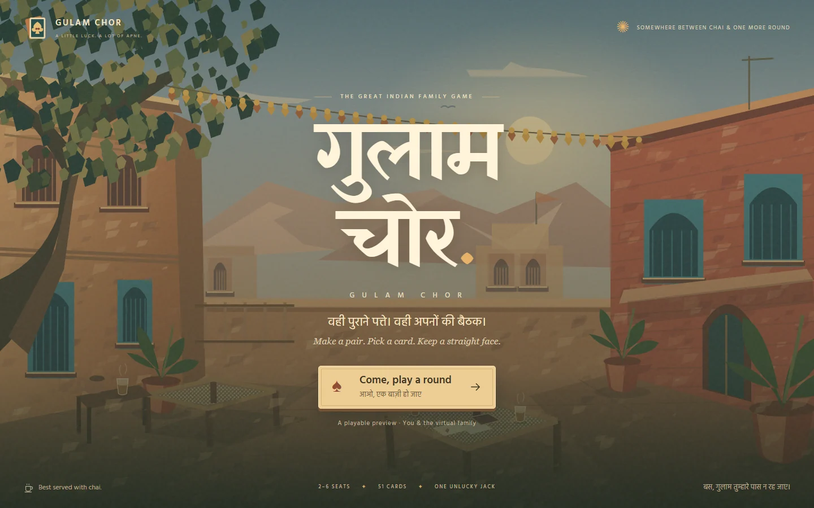

# Gulam Chor · गुलाम चोर

A nostalgic Indian courtyard, your friends, and one Jack nobody wants to keep. **Live multiplayer for 2–6 people**, built with Next.js, React, TypeScript, Firebase Authentication, Realtime Database, and Cloud Functions. The website runs on Vercel at **https://gulamchor.vihar.online**.



## Play together

1. Click **Come, play a round**, then **Create a room** or **Join a room**.
2. Enter a name and choose an avatar. Share the six-character code or invite URL.
3. Friends join from their own devices or browsers. The host starts with any number from 2 through 6.
4. Everyone sees the shuffle and deal. One Jack is removed; 51 cards are dealt fairly and matching ranks are paired automatically.
5. Draw from the next active anticlockwise seat. Empty hands are safe; the last Jack's holder is the Gulam Chor.
6. The host can deal a rematch or return everyone to the lobby to change players.

Reopen an invite in the same browser to restore your anonymous seat. After 60 seconds without a move, anyone in the room can request a server-selected random draw for the waiting player. Rooms expire after 24 hours without activity. Leaving the lobby transfers host duties; the host can remove seats there.

## Setup and deploy

Use **Node.js 22**. See **[Firebase and Vercel deployment](docs/DEPLOYMENT.md)** for environment variables, rules, cost controls, and deployment commands.

```sh
npm ci
npm ci --prefix functions
# Copy .env.example to .env.local for the configured Firebase project.
npm run dev
```

```sh
npm test                     # 500 simulated full rounds plus room validation tests
npm run lint
npm run build
npm run typecheck
npm --prefix functions run build
```

For isolated backend tests, install Java 21+, run `npm run emulators` in one terminal and `npm run test:integration` in another. Tests use `demo-gulam-chor` and cover real SDK calls, concurrent joins, database rules, duplicate draws, all player counts, rematches, and cleanup. CI runs these checks too.

## Authority, privacy, and cost

All shuffles, deals, draws, seat changes, and results run in a callable Firebase function. Transactions reject stale revisions and out-of-turn moves. Members can read only the public table and their own private hand. Clients cannot read the deck, hidden slot mapping, other hands, owner records, or room listings, or write game state directly.

Realtime listeners subscribe only to the public table and the current player's hand. Functions scale to zero, with a two-instance maximum. A bounded daily job clears expired rooms. These controls reduce cost, but Blaze billing is usage-based and cannot guarantee a zero bill.

The landing and rules pages have canonical URLs, social previews, and structured game metadata. `/sitemap.xml` advertises **weekly** changes and revalidates after **604800 seconds (one week)**. `/robots.txt` permits crawling. Private play pages use `noindex,follow` and are excluded from the sitemap. Search engines decide when to crawl and index.

## Artwork and project notes

The Indian courtyard design, responsive table, keyboard controls, optional synthesized sounds, and reduced-motion support are preserved. Avatars are independent of seat order. Fonts are bundled locally.

- [Artwork handoff](art-direction/README.md): 15 prompts, image slots, and SVG fallbacks. Save paintings under `public/art/generated/` and run `npm run art:sync`.
- [Verification](docs/VERIFICATION.md): current checks and deployment evidence.
- [Original visual plan](docs/GAME_AND_VISUAL_PLAN.md) and [research](docs/RESEARCH.md): historical context; local-only preview plans are superseded by this implementation.
- [Original specification](Gulam_Chor_Game_Specification.md): preserved unchanged; subsequent user directions take precedence.

The pure engine is `src/lib/game.ts`, room validation is in `src/lib/room.ts`, server entry points are in `functions/src/index.ts`, and the room/table UI is in `src/components/`. Reference-site assets are not distributed here. Fontsource assets retain their licenses.
